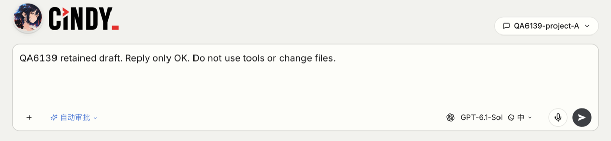

# Issue #6139：项目内新建快捷键验收

核查日期：2026-10-16。关联：https://github.com/makecindy/cindy/issues/6139 。

## 行为与范围

在项目 A 的已有任务内按 ⌘N，新建页应选择 A；旧草稿选 B 时也以当前任务项目为准，保留未发送正文。导航目标只消费一次，之后手动改选 B 保持 B。真实全局任务触发时清除旧项目；已在新建页且没有当前任务来源时不推测项目。

普通新建按钮、应用菜单仍按原通用规则：继承当前设备，同设备保留草稿项目。不引入按项目隔离的独立草稿，不改首条发送的创建流程。

## 根因与修复

- 快捷键原来只继承当前设备，同设备会保留草稿的旧项目。MainLayout 现仅为快捷键 opt-in 项目继承。
- projectWorkingDir 三态：字符串指定项目；null 明确全局；undefined 沿用通用设备迁移规则。NewMakerDraftRoute 统一通过 applyDraftTarget 迁移，再 replace 消费请求；正文沿用现有 composer draft。
- 远程投影按设备分片查询：sticky deviceId 确定后调用 getDeviceSessions(deviceId)。两个设备存在同 ID 任务时，不再混配“设备 B + 项目 A”；目标设备缺行时不借另一设备或本地行。
- 只在项目实际变化、设备变化或明确不保留时迁移；同设备同项目不关闭已有协同偏好。

## 红绿回归

| 检查 | 修复前 | 修复后 |
| --- | --- | --- |
| 远程同 ID / 目标设备缺行 | 34 项中 2 项因错误的 A 目录失败，退出 1；不是缺 mock | 34 项通过，退出 0 |
| 同设备同项目协同 | 挂载真实路由后 enabled 从 true 变 false，退出 1 | 保留偏好，退出 0 |
| 显式项目迁移对照 | 临时禁用迁移条件，A 仍停 B、null 仍停 B，两项失败 | finally 恢复后 4 项组件行为测试通过 |

newMakerShortcutDraftBehavior.test.tsx 使用真实路由、newMakerDraft/composerDraftStore、目标迁移与项目选择 handler；外部目录/服务及非目标 UI 有替身。真实编辑器、发送与持久化另由以下实机场景覆盖。

## 自动验证

执行于基线 d39cbf9b20ede3e0ff060f674a349fcea77f0e56 加本次源码修改；实机前后 9 个 TS/TSX 哈希一致，未为文档更新重复整套检查。

- 定向 Vitest：12 文件、359 项通过，退出 0。覆盖 genericNewMakerRouteState、newMakerRouteState、newMakerGenericCreatePreservesDraft、newMakerShortcutDraftBehavior、dialogueSidebarSection、newMakerProjectPicker、newMakerOrcaCreateOrder、applicationMenuCommands、new-maker-window-shortcut、projectGrouping、newMakerDraft、newMakerDraftWorkspaceReset。
- 9 个改动 TS/TSX 文件的定向 ESLint：退出 0。
- pnpm --filter desktop run --if-present typecheck：完整结束，退出 0，无诊断。
- git diff --check：退出 0。

历史未结束的 typecheck、旧 254 项检查和测试者的场景建议均不计作本次通过。未运行全仓测试或发布打包；改动限 Renderer 路由状态，完整合并门禁交由 CI。

## 隔离实机

环境：macOS arm64，Global，warm-edison 专属隔离沙箱；通过 whoami、进程/端口、版本角标与加载源码路径核对一致。用户已自行处理入口协议，使用本机模式；不复制凭证、不操作正式 profile 或其它任务。测试只使用新建的 QA6139-project-A、QA6139-project-B 空目录及专用任务，短消息要求“只回复 OK，不使用工具或改文件”。实际模型为 Codex / GPT-6.1-Sol。

| 场景 | 实见 |
| --- | --- |
| 旧 B 目标及正文，从真实 A 任务按系统 ⌘N | 目标 A，真实编辑器保留原正文；history 中目标请求已消费 |
| 消费后手动选 B | 等待后仍 B；正文保留，首条发送以 B 创建 |
| 从真实全局任务按系统 ⌘N | 已读回来源 workspaceKind=dialogue；新建页 workingDir=null，正文保留 |
| 普通新建按钮 | 从 A 进入仍保留 B 草稿项目 |
| 应用菜单 | 用真实指针点击“文件 → 新建任务”，普通菜单日志对应 new-maker，保留 B；辅助功能 AXPress 被记成快捷键的尝试不算菜单证据 |
| 保持 A 直接发送 | 收到 OK；列表重开、整页刷新后 workspaceKind=project、目录 A |
| 手动 B 首条发送 | 收到 OK；列表重开、整页刷新后 workspaceKind=project、目录 B |
| 取消目录选择 | B 目标和正文保留，未新增任务 |
| 目录故障及恢复 | 仅将自建 B 目录短暂替换为非目录文件，真实 WORKDIR_MISSING；失败任务仍属 B、正文保留在待发送队列。finally 恢复目录后，界面重试在同一任务收到 OK，总数保持 6，无错归全局或重复任务 |
| 正常退出、同沙箱重开 | 官方隔离启动入口返回 ready、退出 0；root/HEAD/userData 与已验收实例一致。重开后全局、A、手选 B、故障恢复 B 均读回原归属；A/B 从列表重开仍显示 OK |

截图取自真实操作，仅裁剪与缩小；完整读回和运行记录在本次交付附件中。浏览器注入 Meta+N 没有触发桌面事件，不作通过证据；已改用针对本实例的系统 ⌘N。

## 限制与自审

- 远程同 ID、目标设备缺投影、同项目协同偏好由自动回归覆盖；未配置第二台真实设备或在实机启用协同。
- Light 业务页已目检，Dark 未实机目检；本次不新增视觉控件、样式或文案，沿用现有主题 token，不把样式复用说成双模式已目检。
- 自审确认快捷键 opt-in、三态与一次性消费；设备和项目来自同一分片；按钮/菜单保持原路径。SSH 不推测主机目录，不改 IPC、数据库、协议或重连路径，Mobile 无新增入口。
- 不包含 sqlite-vec 启动 LFS 资产、日志、凭证、私有工程框架或协调记录。
